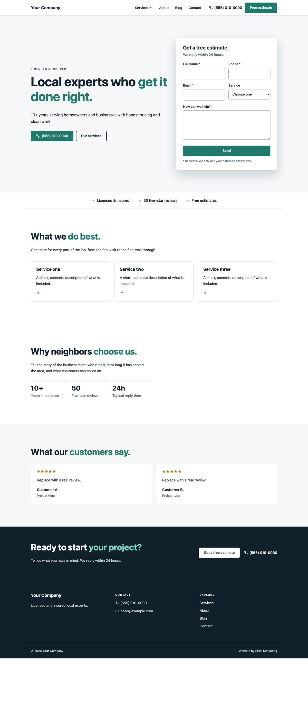
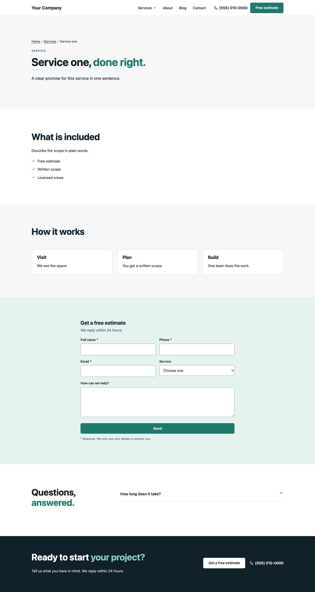

# ElRoi Starter

**The base theme for every custom website by [ElRoi Marketing](https://elroi.marketing/).**

A lean, hand-coded WordPress theme made to work with [ElRoi Site Editor](https://github.com/titosoriano/elroi-site-editor): the design lives in code, and every word and picture the client may change is a simple form in wp-admin. No page builder, no parent theme.

## What is included

- **Page templates:** home, service page, general page (about, policies), contact page, blog, single post and 404.
- **Editable content everywhere:** hero, services, about with key facts, reviews, sections with checklists and cards, FAQs and a call to action, all registered with ElRoi Site Editor and filled with placeholder copy.
- **Site Settings:** business name and type, phone, email, address, opening hours, numbers shown on the site, the services in the contact form, and social profiles.
- **Lead form:** saved in WordPress, emailed, and optionally sent to HighLevel (contact, tags, note and opportunity) with a Cloudflare Turnstile spam check. Keys live in `wp-config.php`, never in the code.
- **Local SEO:** business, breadcrumb and FAQ structured data, ready to sit next to Rank Math.
- **Optional cinematic motion:** GSAP, ScrollTrigger and Lenis smooth scroll, self-hosted and off until the theme turns them on, with simple attributes for word-by-word headings, parallax, shutter reveals and videos that play on screen.
- **Accessible by default:** skip link, visible focus, keyboard dropdowns, a mobile menu that locks the page behind it, labelled form fields, reduced-motion support.
- **One file to brand it:** colors, fonts and radius in `assets/css/tokens.css`.
- **Built for Rank Math:** business details, service areas, FAQs and breadcrumbs go into Rank Math's structured data, clients can add inline links, and the score check fails any page scoring under 80.
- **Forms designed first, connected last:** the built-in form keeps every message in wp-admin; paste a CRM form (HighLevel, HubSpot, Jotform...) under Form messages > Connect a form and it appears in the same designed box on every page. Site Health reminds you while it is not connected.
- **Videos Google can find:** a video field with a fast cover-and-play player and VideoObject structured data.
- **Readable posts:** an automatic "On this page" list on longer blog posts.
- **Lighter photos:** WebP copies for new uploads and the right photo size for each screen.
- **Updates itself:** client sites run the starter as the parent theme and get its improvements as a normal theme update.
- **Backup check:** Tools > Site Health warns when there is no recent off-site backup.
- **Blog that fills whole rows:** a featured newest post plus 9 cards on page 1 and 12 after, so no post sits alone on a last page; reading time, updated dates and "Keep reading" on posts, credited to the business.
- **Service area pages:** one template for a hub, its counties and their towns, with town lists built from the page tree, local business markup per place, and the Google rating from the free Trustindex plugin.
- **More than one office:** extra offices in Site Settings show in the footer and in the business markup.
- **Widgets without code:** a service page can show a manufacturer color tool, map or booking calendar from an allowed site, sized to grow with its width.
- **Analytics key events:** calls, emails, WhatsApp, estimate buttons and sent forms go to Google Analytics when Site Kit is connected.
- **Mega menu (optional):** services or towns in a full-width panel with photo previews, built from the WordPress menu.
- **Accessibility preferences (optional):** an in-house panel with text size, dyslexia font, color modes, reading guide, read aloud and more. No third-party overlay.
- **In-text links:** list each key page and the words for it in Site Settings, and natural mentions in page and blog text link to it (5 a page at most, never in headings).
- **Rank Math scores in seconds:** `tests/rank-math/score.js` runs Rank Math's own analyzer on an export from `wp es seo-papers`, with no browser or password, and fails any page under 80.
- **Freshness and Service schema:** service pages describe the service, its provider and area in structured data, and pages show when they were last updated.
- **Nothing blocks the first paint:** the theme's stylesheets print inside each page (minified, cached until the file changes) instead of as separate files, fonts the first screen uses can be preloaded, and WebP never reaches the site icon or link previews.
- **Speed settings that keep the animations working:** Tools > Site Health > Speed settings sets LiteSpeed Cache safely in one click (cache on, minify on; JS delay, combine, unused-CSS and LiteSpeed lazy load off), keeps pages fresh in visitors' browsers, and reports Google Fonts added by plugins.
- **Animations only where used:** with `'load' => 'auto'`, pages without effects load none of the motion libraries.
- **Automatic checks:** every push runs the tests on GitHub; releases run them first. New client themes get the same checks.

## Starting a client website

1. Run `sh bin/new-client.sh acme-website "Acme Roofing"`. It creates a **child theme** of the starter for the client; push it to a private repository.
2. Brand it in the child's `assets/css/tokens.css`, then design and register the client's pages (see [`AGENTS.md`](AGENTS.md)).
3. On the client's WordPress: install [ElRoi Site Editor](https://github.com/titosoriano/elroi-site-editor/releases/latest) and [ElRoi Starter](https://github.com/titosoriano/elroi-starter/releases/latest) (`elroi-starter.zip`), then upload and activate the child theme. ElRoi Site Editor lists the other plugins every site needs under Plugins > ElRoi recommended.

Starter improvements reach every client as a normal theme update ("New version available" for ElRoi Starter); the client's own design in the child theme is never touched.

## Releases

Bump the version in `style.css` and `functions.php`, push to `main`, and the Release workflow runs the checks, then builds `elroi-starter.zip` and attaches it to a new GitHub release. Sites pick it up from there.

## Requirements

WordPress 6.5+, PHP 8.1+, and the ElRoi Site Editor plugin (1.1+ for the Rank Math features).

## License

GPL-2.0-or-later. Made by [ElRoi Marketing](https://elroi.marketing/).
